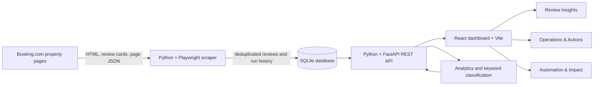

# Azzurro Hotels — Booking.com Review Insights

Operations dashboard for collecting and understanding guest reviews across Olympic Hotel Paddington, Potts Point, Central Sydney, and Darling Harbour. The application stores collected reviews in SQLite and provides a searchable review feed, property and date filters, weekly rating comparisons, positive and negative trends, operational topic insights, corrective action tracking, and collection monitoring.

## 1. Source code

The complete source repository is [Azzurro-hotels-review-insights](https://github.com/hakeemsallauddin/Azzurro-hotels-review-insights). It contains the Python/FastAPI backend, Playwright scraper, React/Vite dashboard, tests, documentation, and a small real-review sample. The full SQLite database and Booking.com browser session are local-only and are not committed.

## 2. Setup, usage, architecture, and limitations

### Setup and installation

Install Python 3.10+, Node.js 20+, and npm. From the project root, create the Python environment, install the backend dependencies, and install Playwright Chromium:

```powershell
py -3 -m venv .venv
.\.venv\Scripts\Activate.ps1
python -m pip install -r requirements.txt
python -m playwright install chromium
```

If PowerShell blocks activation, run `Set-ExecutionPolicy -Scope Process -ExecutionPolicy RemoteSigned` in that terminal, then activate again. Start the API in the first terminal:

```powershell
$env:AUTO_SCRAPE = "false"
python -m backend.run_api
```

In a second terminal, install and start the frontend:

```powershell
cd frontend
npm install
npm run dev
```

Open <http://127.0.0.1:5173>. The API runs at <http://127.0.0.1:8000> and its interactive documentation is at <http://127.0.0.1:8000/docs>. Keep both terminals open. The default database is `data/reviews.sqlite3`; use `AZZURRO_DB` to change its location. A fresh clone does not contain `reviews.sqlite3` (it is local-only), so the API automatically serves the shipped snapshot `data/reviews-public.sqlite3` until a working `reviews.sqlite3` exists — the dashboard shows the collected reviews immediately after setup, with no extra step. `AUTO_SCRAPE=false` disables automatic background scraping; otherwise the API starts incremental collection and repeats every 12 hours by default (`SCRAPE_INTERVAL_HOURS` changes the interval).

### Running the scraper

Run commands from the repository root with the virtual environment active. An incremental run is appropriate for routine updates; a full run traverses all review pages accessible to the current session:

```powershell
python -m backend.scraper.run_scraper
python -m backend.scraper.run_scraper --mode full
python -m backend.scraper.run_scraper --mode incremental --property venus-potts-point-sydney
```

The dashboard's **Refresh reviews** button also starts an incremental run. If Booking.com presents a human verification page, use a visible browser session and complete the check yourself; the collector waits and resumes, but does not bypass the check:

```powershell
$env:PLAYWRIGHT_BROWSERS_PATH = "$PWD\.playwright"
$env:BOOKING_HEADLESS = "false"
$env:BOOKING_STORAGE_STATE = "data/booking-state.json"
python -m playwright install chromium
python -m backend.scraper.run_scraper --mode full
```

Do not share `data/booking-state.json`, which may contain session cookies. Review run outcomes in the dashboard or at `GET /api/scrape/status`. A run starting or exiting successfully does not prove that every source review was accessible.

### Architecture and collection method



**Stack:** Python, Playwright, FastAPI, SQLite, React, Vite, JavaScript, and CSS. The scraper commits rows as it progresses and uses unique source IDs, with a deterministic content hash fallback, to avoid duplicate inserts. It collects review records exposed in page JSON responses or rendered review cards and follows available pagination.

Collection completeness depends on the content Booking.com exposes to the current session. The source site may change its page structure, restrict automated access, or show verification; inaccessible reviews cannot be collected by this application. The dashboard compares unique stored reviews with the latest observed listing total when available and reports gaps and run errors. It does not claim completeness from a matching count alone. The dated `data/booking-source-snapshot.json` is historical context, not a live total. At README preparation, the local database had 9,180 rows; the database itself is not included in the repository.

### Insights and known limitations

Ratings drive sentiment labels: 8+ is positive, below 6 is negative, and 6–7.9 is neutral, with a small word-based check for strong text polarity in the middle band. Curated keyword dictionaries tag topics including cleanliness, check-in, staff, noise, facilities, location, room condition, and value for money. Negative issue mentions use negative comment text; praise uses positive comment text. These transparent rules can miss context, negation, sarcasm, and multilingual expressions or assign false matches. Insights are descriptive operational signals, not causal findings or formal staff assessments. The system does not automatically label reviews fake; authenticity cannot be reliably determined from the public page alone.

Business Impact compares equal-length review windows before and after a tracked action. It describes observed changes and cannot prove that the action caused them. Booking listing totals can change, some score-only reviews may have no accessible public review card, and collection may be interrupted by site restrictions.

### Tests

From the project root, run backend tests and the Python syntax check; build the frontend from its directory:

```powershell
.\.venv\Scripts\python.exe -m unittest discover -s tests -v
.\.venv\Scripts\python.exe -m compileall -q backend tests
cd frontend
npm run build
```

## 3. Working application or demo

The local application is available at <http://127.0.0.1:5173> after completing the setup above and starting both services. **Public demo:** not deployed yet. Add the deployed URL here after hosting is configured; `localhost` is only accessible on the local computer.

The current project has been run locally. Public deployment requires a persistent API/worker host, durable storage, environment-specific CORS configuration, and a plan for any manual source verification. SQLite must not be placed on an ephemeral serverless filesystem; for multiple application or worker replicas, use PostgreSQL and a single scheduled collection worker. No hosted demo or deployment configuration is included in this repository yet.

## 4. Sample review data

[`data/sample_reviews.csv`](data/sample_reviews.csv) contains four actual collected review records—one per property—with reviewer names and Booking review IDs omitted. It is a small example dataset, not the complete review history. The full 9,180-row database is local-only and excluded from GitHub; the dashboard fills with reviews when a user runs the scraper into the local database.

## Security

Do not commit Booking credentials, browser cookies, session state, or environment secrets. `.gitignore` excludes `data/reviews.sqlite3` and its journal files, `data/booking-state.json`, `.env` files, virtual environments, `frontend/node_modules/`, frontend build output, and Playwright browser files. Do not force-add these local files.
